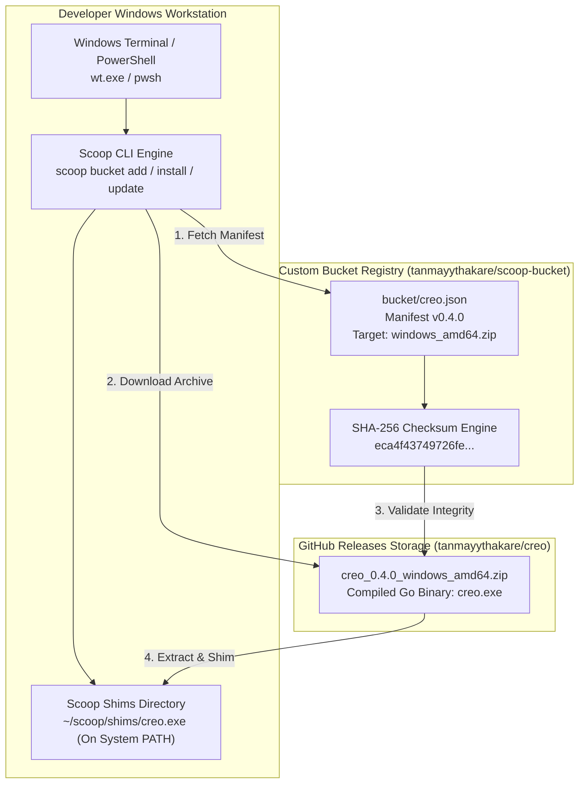

<div align="center">

# Scoop Bucket — Official Windows Package Distribution

**Custom Windows Scoop Package Manager Bucket for Creo & Developer CLI Utilities**

<p align="center">
  <a href="https://scoop.sh/"></a>
  <a href="bucket/creo.json"></a>
  <a href="https://learn.microsoft.com/en-us/windows/terminal/"></a>
  <a href="LICENSE"></a>
</p>

<p align="center">
  Official Scoop package distribution repository for <a href="https://github.com/tanmayythakare/creo">creo</a>.<br>
  One-command installation, cryptographic checksum validation, and seamless binary updates for Windows developers.
</p>

<p align="center">
  <a href="#quick-flow">Quick Flow</a> •
  <a href="#system-architecture">Architecture</a> •
  <a href="#installation--usage">Installation</a> •
  <a href="#available-packages">Available Packages</a> •
  <a href="#core-architectural-pillars">Core Pillars</a> •
  <a href="#verification">Verification</a>
</p>

</div>

---

> [!NOTE]
> **Windows Distribution Hub for the Creo Ecosystem**
> This repository serves as the official package manager registry for **[creo](https://github.com/tanmayythakare/creo)**, the multi-service workspace orchestrator for Windows Terminal (`wt.exe`).
> For the interactive 3D WebGL landing page and simulator, see **[creo-intro](https://github.com/tanmayythakare/creo-intro)**.

---

## Quick Flow

```
scoop bucket add creo-bucket  →  scoop install creo  →  creo up  →  Multi-Service Terminal Tabs
```

---

## System Architecture



---

## Installation & Usage

### Prerequisites
Ensure **[Scoop](https://scoop.sh/)** is installed on your Windows machine:
```powershell
Set-ExecutionPolicy -ExecutionPolicy RemoteSigned -Scope CurrentUser
Invoke-RestMethod -Uri https://get.scoop.sh | Invoke-Expression
```

---

### Step 1: Add the Custom Bucket
Add this repository to your local Scoop configuration:
```powershell
scoop bucket add creo-bucket https://github.com/tanmayythakare/scoop-bucket.git
```

---

### Step 2: Install Creo
Install the Creo CLI binary:
```powershell
scoop install creo
```

Scoop will download the verified release archive, validate the cryptographic SHA-256 hash, extract `creo.exe`, and create an executable shim in `~/scoop/shims/`.

---

### Step 3: Upgrade to New Releases
When new versions of Creo are released, update your bucket index and binary in one step:
```powershell
scoop update creo-bucket
scoop update creo
```

---

### Removing the Package
To remove Creo and unregister the bucket:
```powershell
scoop uninstall creo
scoop bucket rm creo-bucket
```

---

## Available Packages

| Package | Version | Description | Upstream Repository | Manifest |
| :--- | :--- | :--- | :--- | :--- |
| **creo** | `0.4.0` | Multi-service workspace orchestrator for Windows Terminal (`wt.exe`) | [tanmayythakare/creo](https://github.com/tanmayythakare/creo) | [`bucket/creo.json`](bucket/creo.json) |

---

## Core Architectural Pillars

### 01. One-Command Ingestion
* **Frictionless Onboarding**: Developers can install and manage Creo without manual PATH modifications, ZIP extractions, or administrative privileges.
* **Declarative Manifests**: Version definitions, download URIs, bin mappings, and release metadata are defined declaratively in clean JSON schemas.

### 02. Cryptographic Checksum Integrity
* **Deterministic Verification**: Every release archive is validated against an explicit SHA-256 hash (`eca4f43749726fe1b943eb14696ae3a4017e246ab68f529d71ee17c47510ecd4`) prior to extraction.
* **Supply Chain Security**: Prevents corrupted downloads, incomplete payloads, and unauthorized payload modifications.

### 03. Automatic Binary Shimming
* **Native Execution**: Automatically places `creo.exe` into Scoop's global shims directory (`~/scoop/shims/`), making the tool immediately accessible across PowerShell, Command Prompt, Git Bash, and Windows Terminal.
* **Zero System Contamination**: Installs cleanly in user space without polluting Windows system directories or requiring registry edits.

### 04. Continuous Upstream Synchronization
* **Automated Version Tracking**: Bucket manifests directly reference semantic version releases from the core Go repository.
* **Atomic Rollbacks**: Scoop maintains version history, allowing seamless downgrades if necessary via `scoop reset creo@<version>`.

---

## Verification

After installation, verify that Creo is properly mapped and ready for orchestration:

```powershell
# Check binary location in Scoop shims
scoop which creo

# Check Creo version output
creo version

# Initialize workspace configuration in any multi-service project
creo init
```

---

## Repository Structure

```
scoop-bucket/
├── bucket/
│   └── creo.json       # Scoop manifest (version, architecture, URL, bin, hash)
├── .gitignore          # Repository hygiene rules
└── README.md           # Documentation & bucket installation guide
```

---

## Contributing

To submit updates to package manifests or propose new developer utilities:

1. Fork the repository.
2. Clone your fork:
   ```bash
   git clone https://github.com/tanmayythakare/scoop-bucket.git
   ```
3. Update the version string, download URL, and SHA-256 hash in `bucket/<package>.json`.
4. Test locally:
   ```powershell
   scoop install .\bucket\creo.json
   ```
5. Commit and submit a Pull Request.

---

## License

This project is open-source and distributed under the **[MIT License](LICENSE)**.

---

## Author

**Tanmay Thakare**
* GitHub: [@tanmayythakare](https://github.com/tanmayythakare)
* Email: [tanmayrthakare@gmail.com](mailto:tanmayrthakare@gmail.com)
* LinkedIn: [Tanmay Thakare](https://www.linkedin.com/in/tanmaythakare)

---

<div align="center">
  <a href="https://github.com/tanmayythakare">
    
  </a>
</div>
